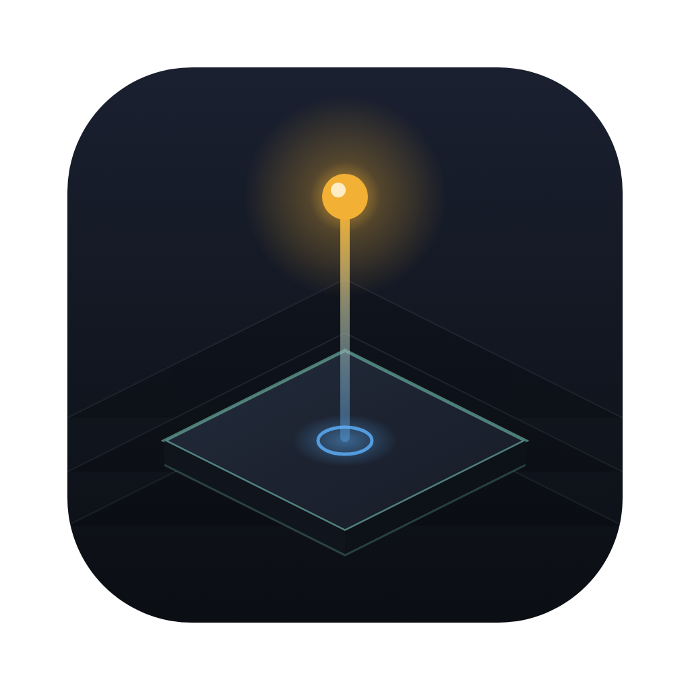
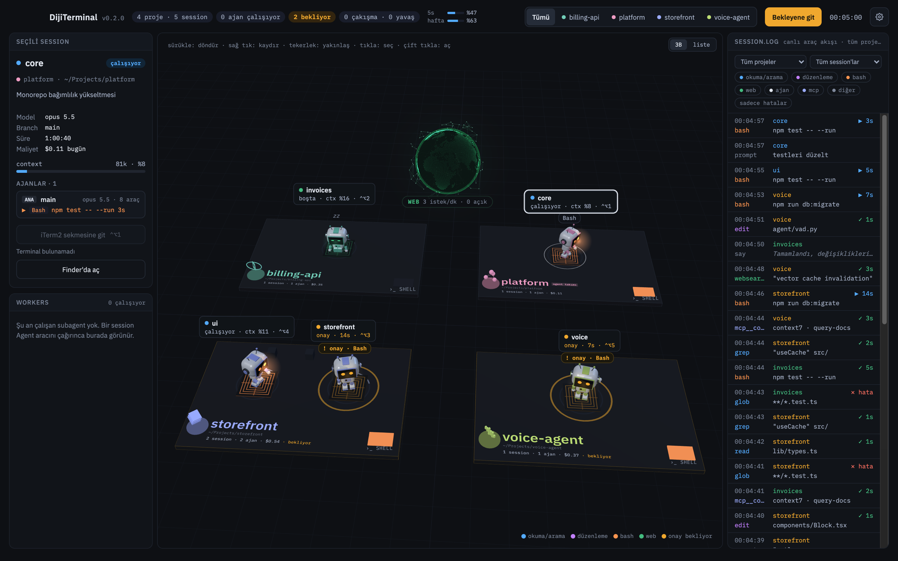
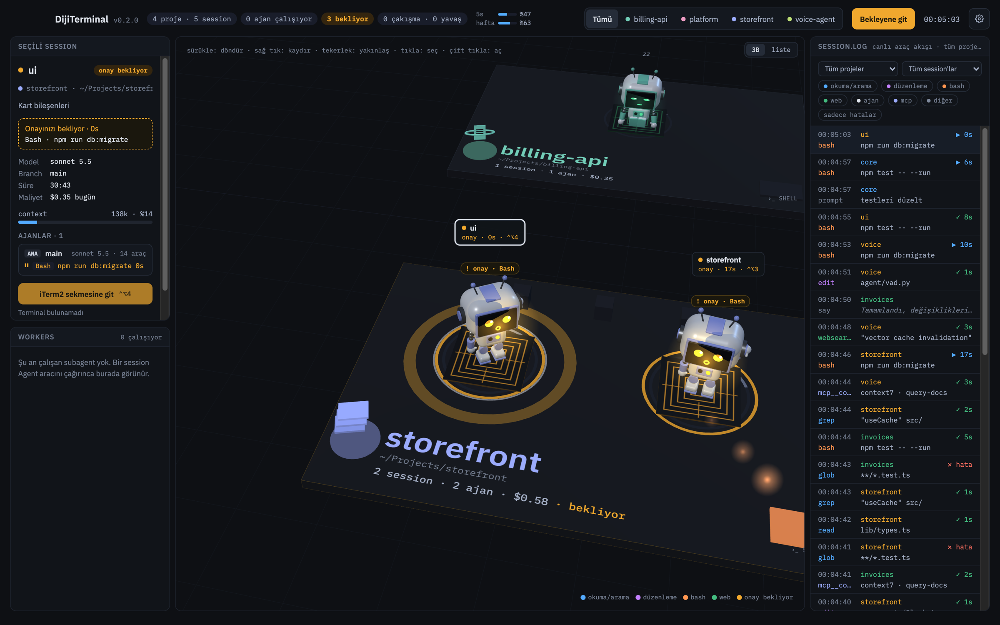
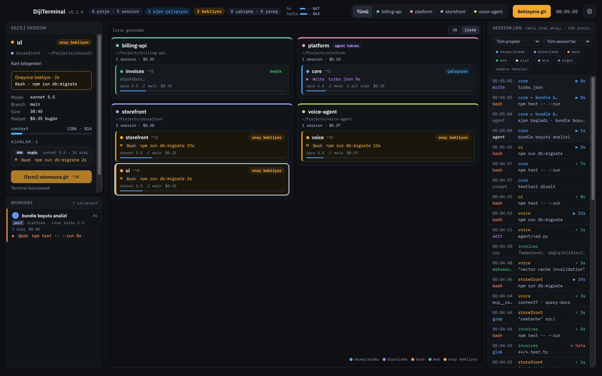

<div align="center">



# DijiTerminal

**Paralel çalışan Claude Code session'larınız için ikinci monitör kontrol paneli.**

Hangi session çalışıyor, hangisi onayınızı bekliyor, hangi ajan ne yapıyor — tek bakışta.

[](https://github.com/ufukaytas/DijiTerminal/releases/latest)


[](LICENSE)

[**İndir**](https://github.com/ufukaytas/DijiTerminal/releases/latest) · [Özellikler](#özellikler) · [Kurulum](#kurulum) · [Nasıl çalışır](#nasıl-çalışır) · [Geliştirme](#geliştirme)



</div>

## Neden?

Birden fazla Claude Code session'ı aynı anda çalıştırınca asıl zaman kaybı beklemekte geçer: bir session dakikalardır onay bekler, diğeri bitmiştir, bir alt ajan takılmıştır — ve bunu ancak sekmeleri tek tek gezince fark edersiniz. DijiTerminal tüm session'ları canlı olarak tek ekranda toplar, dikkatinizi gerektiren anı size bildirir ve bir tıkla doğru terminal sekmesine götürür.

## Özellikler

- **3B session haritası** — her proje bir platform, her session bir robot ekibi. Robotlar yazar, onay isterken el kaldırır, alt ajanları beklerken tarar, boştayken uyur. Web aramaları ortadaki dünya küresinde uydu olarak görünür.
- **Onay bekleyenler önce** — bekleyen session'lar vurgulanır; bildirim, Dock rozeti ve menü çubuğu sayacı aynı yerden beslenir. `⌃⌥W` en uzun bekleyene götürür.
- **Tek tıkla iTerm2'ye** — kart, robot ya da bildirimden doğrudan ilgili iTerm2 sekmesine geçin; `⌃⌥1…9` ile session kısayolları.
- **Canlı araç akışı** — `session.log` her araç çağrısını süresi ve sonucuyla gösterir; proje, session, araç türü ya da yalnızca hatalara göre süzülür.
- **Ajanlar ve alt ajanlar** — Workers paneli çalışan subagent'ları, araç sayılarını ve maliyetlerini listeler.
- **Maliyet, context ve limitler** — session başına model, branch, süre, liste fiyatıyla tahmini maliyet ve context doluluğu; 5 saatlik ve haftalık kullanım limitleri üst barda.
- **Gömülü terminal** — `claude --bg` ile başlatılan arka plan session'ları uygulamanın içindeki sekmeli terminalde açılır; yeni session başlatma, durdurma ve geçmişten yeniden açma.
- **Menü çubuğu modu** — pano kapalıyken bile durum ikonu ve bekleyen sayısı; açılan listeden session'a atlayın.
- **Yerel ve salt okunur** — veriler yalnızca Mac'inizde kalır; ağ erişimi yoktur. Bkz. [Gizlilik](#gizlilik-ve-güvenlik).

<table>
  <tr>
    <td width="50%"></td>
    <td width="50%"></td>
  </tr>
  <tr>
    <td align="center"><sub>Seçili session — onay bekleyen komut, model, maliyet, context</sub></td>
    <td align="center"><sub>Liste görünümü — projelere göre gruplanmış session'lar</sub></td>
  </tr>
</table>

<sub>Ekran görüntüleri sentetik verilerle demo modunda alınmıştır (`npm run dev:demo`).</sub>

## Kurulum

**Gereksinimler:** macOS 13 veya üzeri · [iTerm2](https://iterm2.com) · [Claude Code](https://claude.com/claude-code)

1. [Son sürümden](https://github.com/ufukaytas/DijiTerminal/releases/latest) Mac'inize uygun `.dmg`'yi indirin — **arm64** (Apple Silicon) ya da **x64** (Intel) — ve DijiTerminal'i **Applications** klasörüne sürükleyin. Sürümler Developer ID ile imzalı ve Apple tarafından notarize edilmiştir.
2. Uygulamayı açın, **Ayarlar (⌘,) › Hook'lar** bölümünden Claude Code hook'larını ve status line'ı kurun. Hook'lar onay bekleme ve tur bitişi gibi anlık durumları, status line ise kullanım limitlerini getirir; kurulum `~/.claude/settings.json`'a yalnızca DijiTerminal girdilerini ekler ve aynı yerden kaldırılabilir.
3. İlk "iTerm2 sekmesine git" tıklamasında macOS iTerm2'yi kontrol izni ister → **İzin Ver**. Reddettiyseniz: Sistem Ayarları › Gizlilik ve Güvenlik › Otomasyon › DijiTerminal › iTerm.

İsteğe bağlı: **Ayarlar › Girişte başlat** ile uygulama oturum açılınca penceresiz başlar; **Menü çubuğu** bölümünden Dock ikonunu gizleyebilirsiniz.

## Nasıl çalışır

```
 Claude Code session'ları ──► ~/.claude/projects/*.jsonl   (transcript'ler, salt okunur izlenir)
            │
            ├──► hook olayları ──────► hook-events.jsonl    (onay bekliyor, tur bitti …)
            └──► status line ───────► kullanım limitleri
                                            │
                     ps (3 sn'de bir) ──────┤  süreç ↔ terminal sekmesi eşleşmesi
                                            ▼
                                  session motoru (Node)
                                            │  tipli IPC
                                            ▼
               3B harita · paneller · bildirimler · menü çubuğu · gömülü terminal
```

Motor saf Node ile yazılmıştır ve Electron'dan bağımsız olarak test edilir; arayüz React ve three.js ile çizilir.

## Gizlilik ve güvenlik

- **Tamamen yerel.** Ağ erişimi, telemetri ve otomatik güncelleme yoktur; prompt'larınız ve kodunuz Mac'inizden çıkmaz.
- **Salt okunur.** `~/.claude` altındaki dosyalar yalnızca okunur; tek yazma işlemi, sizin onayınızla yapılan hook kurulumudur.
- **Neden App Store'da değil?** Uygulama `~/.claude`'u okumak ve iTerm2'yi `osascript` ile kontrol etmek için App Sandbox dışında çalışır; Mac App Store bunu kabul etmez. Bu yüzden Developer ID ile imzalanıp notarize edilerek doğrudan dağıtılır.

## Geliştirme

Gereksinimler: macOS 13+, Node 22.12+ (`nvm use`), iTerm2.

```sh
npm install        # postinstall Electron'un macOS sürümünü indirir
npm run dev        # geliştirme modu (HMR)
npm run dev:demo   # gerçek veri okumadan sentetik session'larla
npm run test:all   # Vitest + hook testleri
```

<details>
<summary><b>Tüm komutlar</b></summary>

| Komut | Ne yapar |
|-------|----------|
| `npm run dev` | Electron'u HMR ile açar |
| `npm run dev:demo` | Demo motoruyla açar; dosya okumaz |
| `npm run build` | main, preload ve renderer'ı `out/` altına derler |
| `npm run dist` | `release/` altında arm64 + x64 .dmg ve arm64 .zip (ad-hoc imzalı); `build:mac` aynı |
| `npm run dist:universal` | Tek universal .dmg |
| `npm run dist:dir` | Yalnızca `.app` klasörü (hızlı paket denemesi) |
| `npm run dist:signed` | Developer ID ile imza + hardened runtime (`CSC_NAME`); `APPLE_KEYCHAIN_PROFILE` varsa uygulama ve .dmg notarize edilir |
| `npm run dist:notarize-dmg` | `release/` altındaki imzalı .dmg'leri notarize edip bileti ekler |
| `npm run dist:check` | Paketleme yapılandırmasını doğrular; Mac'te `-- --app release/mac-arm64/DijiTerminal.app` ile paketi de denetler |
| `npm run icon` | `build/icon.svg` → `build/icon.png` + `build/icon.icns` |
| `npm run icon:tray` | Menü çubuğu ikonlarını (`resources/tray/*Template.png`) üretir; `-- --preview <png>` önizleme |
| `npm run typecheck` | main ve renderer tsconfig'lerini ayrı ayrı denetler |
| `npm run lint` | ESLint (shared/renderer/motor import kuralları dahil) |
| `npm test` | Fixture taraması + Vitest (motor, ortak kod, renderer) |
| `npm run test:hooks` | Hook testleri (shell + node:test) |
| `npm run test:all` | İkisi birden |
| `npm run hooks:install` / `hooks:uninstall` / `hooks:status` | Claude Code hook ve statusLine kurulumu (CLI) |
| `npm run fixtures:make -- --synthetic` | Test senaryolarını yeniden üretir |
| `npm run fixtures:check` | Fixture'larda gerçek veri izi arar |
| `npm run replay -- <senaryo> --speed 5` | Bir senaryoyu geçici bir `CLAUDE_CONFIG_DIR`'e canlı oynatır |
| `npm run bench:transcripts` | Transcript okuyucunun açılış süresini ölçer |
| `npm run bench` / `bench:hidden` / `bench:big` / `bench:soak` / `bench:headless` | Performans bütçesi ölçümü — bkz. [docs/performance.md](docs/performance.md) |

</details>

<details>
<summary><b>Klasör yapısı</b></summary>

```
src/
  shared/      ortak tipler, IPC kontratı, sabitler (electron/Node importu yasak)
  main/        Electron main process
    engine/    session motoru — saf Node, electron importu yasak
  preload/     window.diji köprüsü
  renderer/    React arayüzü
hooks/         hook script'leri ve kurulum aracı
scripts/       CLI araçları (kurulum, fixture, replay, benchmark, notarization)
fixtures/      sentetik ve anonim test verisi
tests/         Vitest testleri + tests/hooks (shell)
build/         ikon kaynağı (SVG) ve üretilmiş PNG/ICNS, entitlement'lar
docs/          performans notları, ekran görüntüleri
```

</details>

<details>
<summary><b>Kendiniz derlemek ve imzalı sürüm almak</b></summary>

`npm run dist` ad-hoc imzalı, notarize edilmemiş paketler üretir: ilk açılışta macOS "geliştirici doğrulanamadı" der → Applications'ta **sağ tık › Aç › Aç**. Ad-hoc her yeni build'de Otomasyon izni yeniden sorulabilir (`tccutil reset AppleEvents com.dijitalai.dijiterminal`).

İmzalı ve notarize sürüm için keychain'de **Developer ID Application** sertifikası ve notarytool kimlik bilgisi gerekir. Kimlik bilgisi bir kez keychain'e kaydedilir; ortam değişkenlerinde sır tutulmaz:

```sh
# App Store Connect API anahtarıyla …
xcrun notarytool store-credentials dijiterminal \
  --key ~/.private_keys/AuthKey_<KEY_ID>.p8 --key-id <KEY_ID> --issuer <ISSUER_ID>
# … ya da Apple ID + uygulamaya özel parola ile
xcrun notarytool store-credentials dijiterminal --apple-id <e-posta> --team-id <TEAM_ID>

CSC_NAME="Developer ID Application: <Ad Soyad> (<TEAM_ID>)" \
APPLE_KEYCHAIN_PROFILE=dijiterminal \
npm run dist:signed
```

`dist:signed` uygulamayı hardened runtime ve `build/entitlements.mac.plist` ile imzalar; electron-builder uygulamayı notarize edip bileti ekler. Ardından `.dmg`'ler imzalanır ve `scripts/notarize-dmg.mjs` onları notarize edip bileti ekler. Doğrulama: `spctl -a -vv release/mac-arm64/DijiTerminal.app` → `source=Notarized Developer ID`.

</details>

**Yığın:** Electron 45 · React 18 · TypeScript 5.9 · three.js 0.160 · electron-vite · Vitest · xterm.js · node-pty

Sürüm notları için [CHANGELOG.md](CHANGELOG.md).

## Lisans

[MIT](LICENSE) © 2026 Ufuk Aytaş
